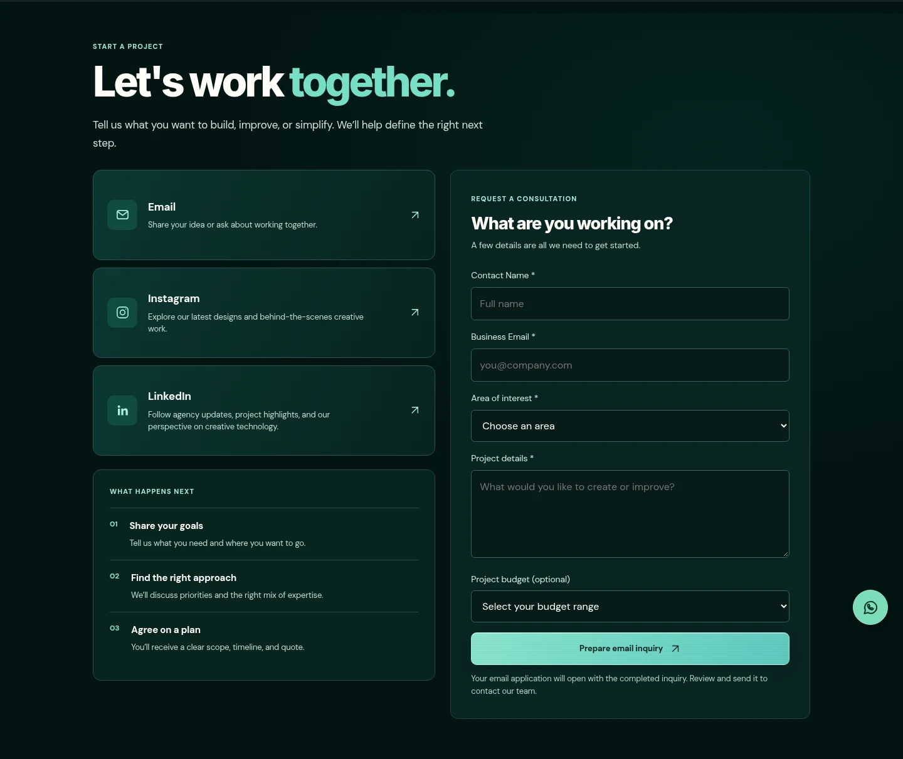

# Artiosis — Creative Technology Agency

**Turning ambitious ideas into digital experiences.**

Artiosis brings **Web Experiences**, **AI & Automation**, and **Creative Solutions** together through a responsive agency website with a dark teal identity, animated visuals, and clear contact options.

[Live website](https://artiosis-two.vercel.app/) · [Services](https://artiosis-two.vercel.app/#services) · [Contact](https://artiosis-two.vercel.app/#contact)

## Project showcase

### Hero & services

A bold headline, animated orbital artwork, and an interactive showcase of the agency’s three areas of expertise.

[](https://artiosis-two.vercel.app/)

### Contact & inquiry

Clickable Email, Instagram, and LinkedIn cards sit alongside a guided project inquiry form. Each card opens its destination directly without repeating the address or username.

[](https://artiosis-two.vercel.app/#contact)

## Features

- Responsive desktop, tablet, and mobile layouts.
- Interactive service tabs, animated backgrounds, and satin-style button interactions.
- Clickable social and email cards, plus a floating WhatsApp contact panel.
- A project inquiry form that prepares an email in the visitor’s email application.
- Published [Privacy Policy](https://artiosis-two.vercel.app/privacy-policy.html) and [Terms & Conditions](https://artiosis-two.vercel.app/terms-and-conditions.html).
- Search and social-sharing metadata, favicon assets, a sitemap, and robots directives.

## Stack & source files

**Next.js 15 · React 19 · TypeScript · HTML/CSS/JavaScript · Vercel**

The production homepage is a standalone HTML document served through the Next.js application. To change what visitors see at `/`, edit **`public/artiosis-final.html`**. The middleware rewrites `/` to that file; `app/page.tsx` is not the live homepage.

| Path | Purpose |
| --- | --- |
| `public/artiosis-final.html` | Live homepage markup, styles, and browser interactions |
| `middleware.ts` | Routes `/` to the approved HTML homepage |
| `app/layout.tsx` | Next.js root layout and framework metadata |
| `public/privacy-policy.html` | Privacy Policy page |
| `public/terms-and-conditions.html` | Terms & Conditions page |
| `public/` | Website images, favicon assets, social-sharing image, sitemap, and robots file |
| `screenshots/` | Images used in this README and the GitHub profile showcase |

When changing homepage search or sharing metadata, keep the HTML `<head>` and `app/layout.tsx` consistent.

## Run locally

Use Node.js 22 LTS and npm.

```bash
git clone https://github.com/JFUIX/artiosis.git
cd artiosis
npm install
npm run dev
```

Open [http://localhost:3000](http://localhost:3000).

For a production build:

```bash
npm run build
npm start
```

The current static website does not require environment variables. External fonts, icons, and contact destinations require an internet connection.

## Inquiry behavior

The form opens a `mailto:` message with the visitor’s project details. The visitor must press **Send** in their email application to complete the inquiry. There is no server-side form submission, lead database, or automatic acknowledgment.

## Deployment

The repository is connected to Vercel. Changes pushed to `main` trigger a production build; they appear on the live website once the deployment is ready.

Production URL: [artiosis-two.vercel.app](https://artiosis-two.vercel.app/).
