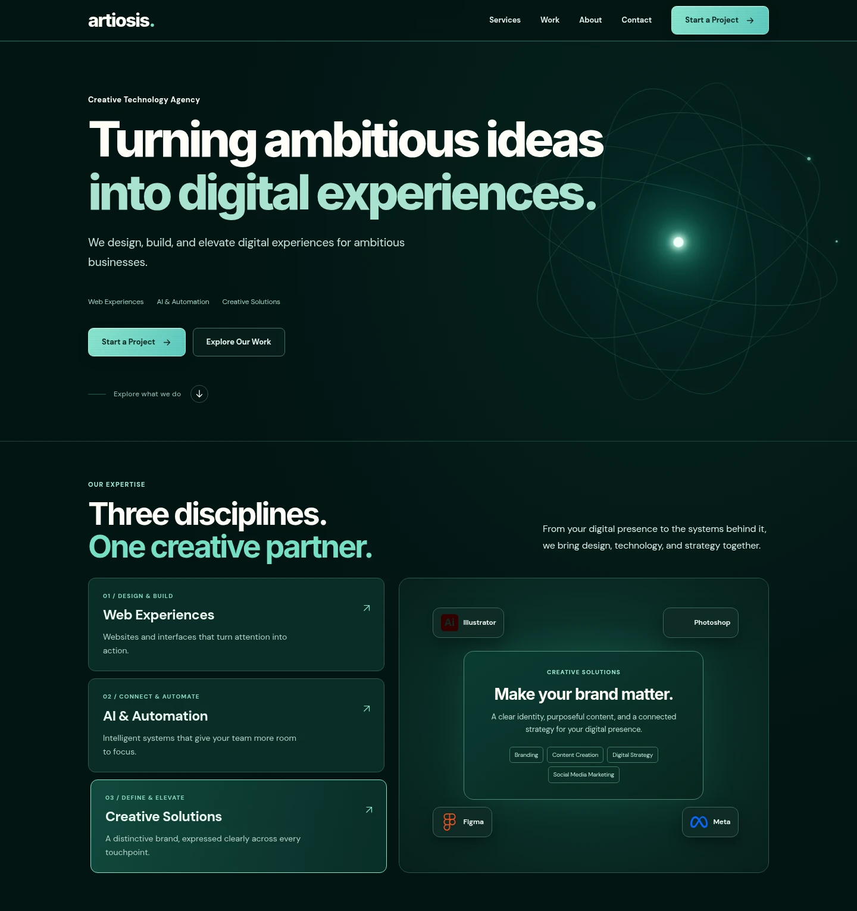
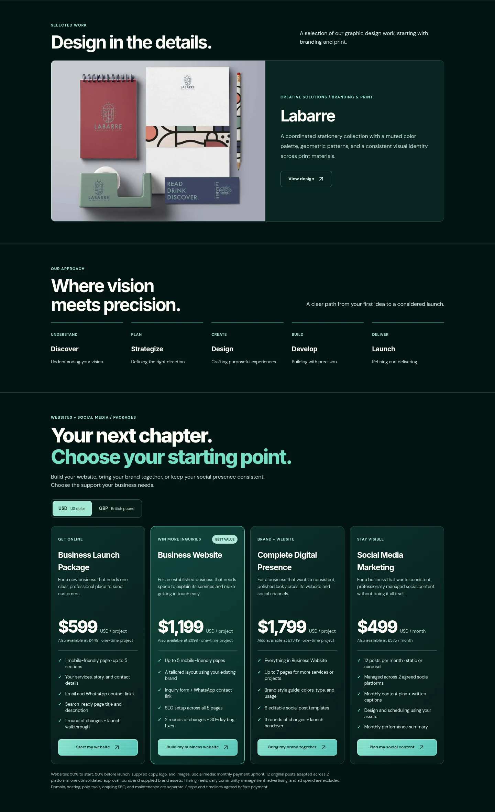

# Artiosis — Creative Technology Agency

Turning ambitious ideas into digital experiences.

A responsive agency website that brings **Web Experiences**, **AI & Automation**, and **Creative Solutions** together in one dark, teal-accented identity.

[View the live website](https://artiosis-two.vercel.app/) · [Explore the packages](https://artiosis-two.vercel.app/#pricing)

## Project showcase

### First impression & expertise

The homepage pairs a bold headline and animated orbital artwork with an interactive showcase of the agency’s three core disciplines.

[](https://artiosis-two.vercel.app/)

### Selected work & clear packages

Real portfolio work, a defined project process, and four packages for websites, branding, and ongoing social media marketing. Prices switch between USD and GBP.

[](https://artiosis-two.vercel.app/#work)

## Features

- Responsive desktop, tablet, and mobile layouts.
- Three interactive service pillars, animated backgrounds, and satin-style button interactions.
- Labarre portfolio showcase, client testimonials, and expandable FAQs.
- Four service packages with USD/GBP switching and inquiry selection.
- Email inquiry preparation, social links, and a floating WhatsApp contact panel.
- Published Privacy Policy and Terms & Conditions.
- Search metadata, social sharing image, sitemap, and favicon assets.

## Development

Built with **Next.js 15, React 19, and TypeScript**; hosted on **Vercel**.

```bash
npm install
npm run dev
```

Open [localhost:3000](http://localhost:3000). For a production build:

```bash
npm run build
npm start
```

The live homepage is `public/artiosis-final.html`, served at `/` through `middleware.ts`. Legal pages and other static assets are in `public/`. The inquiry form opens the visitor’s email application with a prepared message; it does not submit to a server.
